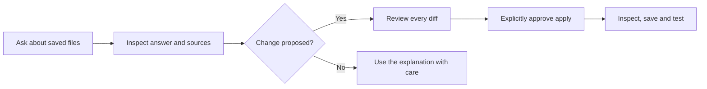

# Thread Agent

### Understand your project. Review AI suggestions. Stay in control.

Thread is a local AI assistant inside **Visual Studio Code (VS Code)**, the app you use to open and edit code. Ask where something happens, get help investigating a bug, review a suggested change, or summarize a document. Thread uses a model running on your computer through **Ollama**; the main workflow needs no paid AI account or API key.

> [!IMPORTANT]
> **Experimental developer preview.** Answers and generated code can be wrong. Thread shows source excerpts and asks you to review changes. The new bundled-backend and offline paths are development candidates, not a finished release for every operating system.

**Explore:** [What it does](#what-can-i-do) · [Choose setup](#choose-your-setup) · [First task](#try-your-first-task) · [Platform status](#platform-status) · [FAQ](#questions-and-help) · [For contributors](#for-contributors)

| 🔎 Understand | 🛠️ Investigate | ✍️ Change | 📄 Summarize |
| --- | --- | --- | --- |
| Ask how your project works, with source references. | Describe an error and inspect a proposed explanation or fix. | Review changes to up to four eligible text files. | Choose text, PDF text or a Word document's main body. |

## What can I do?

| You ask | Thread helps by | Your part |
| --- | --- | --- |
| “Where does this project read its database settings?” | Finding relevant saved source excerpts and explaining them. | Open the sources and check the explanation. |
| “This function gives the wrong result. Why?” | Using your description, source and VS Code diagnostics. | Check the diagnosis; review any proposed fix. |
| “Add input validation to this function.” | Proposing bounded file changes with before/after diffs. | Review each diff, explicitly approve, then inspect/save/test. |
| “Summarize the requirements in this document.” | Summarizing a selected file or range with extraction notes. | Check what was included or omitted. |

Thread reads a bounded selection of **saved files**, rather than understanding every file at once. Save relevant files and open the one you are asking about. It cannot operate debugger breakpoints, silently run generated commands, or remember all earlier conversations. [Detailed limits →](docs/vscode.md#files-documents-and-model-limits)

## Choose your setup

**New here? Start with the VS Code guide.** The existing Python-based preview is the practical route today; the native lightweight and offline routes below are being validated.

| Route | What you need | Where to start |
| --- | --- | --- |
| **Existing editor preview** | VS Code 1.95+, Python 3.9+ and a local text-generation model. On Apple Silicon macOS 14+, confirmed managed setup can install Ollama/model assets. | [Build/install and first setup](docs/vscode.md#build-and-install-from-this-public-repository) |
| **Lightweight native candidate** | A matching platform VSIX containing the backend; local runtime/model assets acquired after confirmation, or an existing local server. A correctly built native package removes the separate Python requirement. | [Distribution paths and prerequisites](docs/distribution-modes.md) |
| **Offline native candidate** | Matching VSIX **and** a trusted companion folder containing runtime/model assets and notices, transferred from a connected computer. | [Offline import steps](#offline-setup-in-plain-english) |
| **Simple field lookup** | Git and Python 3.11+. No AI model or GPU required. This is a separate command-line tool. | [Try a field lookup](#try-a-field-lookup-without-ai) |

A **VSIX** is a VS Code extension installer. A **model** is the downloaded AI data used to generate answers. A **companion bundle** contains the additional files needed for offline setup; it can be much larger than the extension.

> [!NOTE]
> The owner reported publishing version **0.1.0** as `Krishnendra.thread-agent`. This branch develops **0.2.0**; its local candidates have not been published to Marketplace. A public repository or passing CI does not make a new installer available. Check the [release checklist](docs/releasing.md) before distributing packages.

### Install and open the editor preview

1. Follow the [build/install guide](docs/vscode.md#build-and-install-from-this-public-repository) to obtain the local VSIX. Building from source needs developer tools and internet access for dependencies.
2. In VS Code, open **Extensions → … → Install from VSIX…** and select your installer.
3. Open a project you trust. From the Command Palette, run **Thread: Setup Local Model**. The Python-based preview automatically detects Python 3.9+.
4. Select an installed local text model. On a supported Apple Silicon Mac, you can choose **Set up local AI for me (Recommended)** and review/confirm the downloads instead.
5. Open the **Thread** sidebar and choose a workflow.

Downloads need internet and sufficient storage/memory. They do not happen because an AI answer tells Thread to install something. [Setup sizes, terms and recovery →](docs/local-setup.md)

### Offline setup in plain English

1. On a connected computer, obtain the matching VSIX and companion folder from a **trusted distributor**. Official ready-to-download companion releases are not available yet.
2. Transfer both to the offline computer and install the VSIX.
3. Run **Thread: Import Offline Local AI**, select the unpacked companion folder, and compare the shown manifest SHA-256 with the distributor's trusted record. SHA-256 is a fingerprint used to detect changed bytes; it does not prove who made the bundle.
4. Review and explicitly approve the native programs being imported. Thread copies/checks the files, starts its local model server and checks the selected model before activating it.
5. Keep one Thread window active during import. Cancel or a failed import preserves the previous selection and removes incomplete copied files.

One real Apple Silicon Mac import and model response passed with external networking denied. Clean-machine setup and model inference on the other platforms remain to be verified. The companion assembler is a developer tool, not a download service. [Trust boundaries and complete bundle requirements →](docs/distribution-modes.md)

## Try your first task

**Example walkthrough — not a screenshot or a guarantee of model output.** Suppose your saved project contains a small `add` function that subtracts instead of adding:

```python
def add(a, b):
    return a - b
```

1. Open that file and run **Thread: Diagnose a Problem**.
2. Enter: “`add(2, 3)` returns `-1`; I expected `5`. Explain why and propose a fix.”
3. Read the explanation and captured source excerpts. If Thread proposes a change, choose **Review proposed changes** and **Review a diff (recommended)**.
4. Inspect every proposed diff and explicitly mark it reviewed. Choose **Apply to editor buffers**, then confirm **Apply reviewed changes**.
5. Inspect/save the result and run your project checks. Thread can run an existing VS Code task only after you select and confirm it; inspect its terminal output yourself.



You can also refine the proposal with your own instructions, choose **More options**, **Pause review**, or **Cancel proposal**. Custom text and silence do not approve a change. Changed source files invalidate an old proposal. Thread does not automatically save existing-file edits, commit or push; creating an approved new file may write it to disk. [Review controls →](docs/vscode.md#review-and-apply-a-feature-or-fix)

## Platform status

**Native backend CI passed on all six targets** for [commit `3e436ad`](https://github.com/KrishnendraPrakash/thread/commit/3e436adaaa625b26831c8d8a8148f18245d7ee30): builds, JSON/dependency probes, source-boundary tests and synthetic offline-import tests. [Inspect the native run →](https://github.com/KrishnendraPrakash/thread/actions/runs/38142298112)

| Computer | Native backend check | Full editor / real offline AI |
| --- | --- | --- |
| Apple Silicon Mac (ARM64) | Passed on macOS 14 runner | Local editor fixtures and real offline AI trial passed on the development Mac; clean-machine certification pending. |
| Intel Mac (x64) | Passed on macOS 15 Intel runner | Full editor and real model trial pending. |
| Linux x64 | Passed on Ubuntu 22.04 runner | Full editor and real model trial pending. |
| Linux ARM64 | Passed on Ubuntu 24.04 ARM runner | Full editor and real model trial pending. |
| Windows x64 | Passed on Windows 2025 runner, including native handle-read tests | **Editor activation remains gated** pending broader document/edit integration validation. |
| Windows ARM64 | Passed on Windows 11 ARM runner, including native handle-read tests | **Editor activation remains gated** pending broader document/edit integration validation. |

These runner versions are test environments, not a certified minimum OS list. Native CI does not download/run a model. Web, 32-bit and remote-host profiles are outside this initial target matrix. Signing, complete third-party notices and the owner license remain release blockers. [Current evidence and remaining gates →](steering/status.md)

## Questions and help

Click a question to expand it.

<details>
<summary>Does my code go to a cloud AI service?</summary>

The implemented AI path calls a local Ollama server on loopback (your own computer). There is no silent paid/cloud fallback. Confirmed setup downloads runtime/model assets; VS Code and tasks you explicitly run can have their own network behavior. Thread's process boundary is not an OS sandbox. [Privacy details](extensions/vscode/PRIVACY.md)

</details>

<details>
<summary>What does Thread store, and how can I stop it?</summary>

The latest completed editor analysis is saved in workspace state, including source excerpts, proposals and model inputs/outputs. **Thread: Clear Saved Analysis** clears the active entry; it does not erase VS Code backups or undo history. **Thread: Cancel Current Request** stops the client request; a local model server may briefly finish its work. Stop an already approved VS Code task using VS Code task controls. Runtime/model files are separate from analysis. [Storage and cancellation](docs/vscode.md#storage-cancellation-and-troubleshooting)

</details>

<details>
<summary>Can it summarize any PDF or Word file?</summary>

It extracts PDF text and DOCX main-body text, plus supported UTF-8 text files. It does not perform OCR on scans or inspect document images, and Word headers/footnotes may be omitted. Select a smaller page/paragraph/line range when needed. Check extraction notes. [Formats and limits](docs/vscode.md#files-documents-and-model-limits)

</details>

<details>
<summary>Setup or a request failed. What next?</summary>

Rerun **Thread: Setup Local Model** and check the reported backend/model status. For the Python-based package, install a maintained Python 3.9+ if none is detected. Choose a local text-completion model rather than an embedding/cloud model. For rejected output, ask a narrower question; for stale changes, inspect the current files and request a new proposal. [Troubleshooting guide](docs/vscode.md#storage-cancellation-and-troubleshooting)

</details>

<details>
<summary>Is it a finished autonomous agent? Can I redistribute it?</summary>

This is a bounded preview. Durable knowledge memory, independent semantic verification and optional hosted/private adapters remain planned. No full M0/M1/model benchmark gate has passed. The repository's owner license is **not selected** (`UNLICENSED` in extension metadata); public source visibility is not a license grant. Complete portable-Python notices and signing decisions remain open. [Roadmap](AGENT_PLAN.md) · [Release checklist](docs/releasing.md)

</details>

## Try a field lookup without AI

This separate CLI reports an exact TOML/JSON value and its source fingerprint. It does not provide general chat. You need Git and Python **3.11+**; installation may download build tooling.

<details>
<summary>macOS or Linux commands</summary>

```bash
git clone https://github.com/KrishnendraPrakash/thread.git
cd thread
python3 -m venv .venv
source .venv/bin/activate
python -m pip install -e .
thread-agent ask --file examples/projects/minimal/settings.toml --field /database/default
```

</details>

<details>
<summary>Windows PowerShell commands</summary>

Verify `py -3 --version` reports 3.11+ first. Full Windows CLI installation remains to be tested; native source-read CI is a narrower check.

```powershell
git clone https://github.com/KrishnendraPrakash/thread.git
cd thread
py -3 -m venv .venv
.\.venv\Scripts\python.exe -m pip install -e .
.\.venv\Scripts\python.exe -m thread_agent ask --file examples/projects/minimal/settings.toml --field /database/default
```

</details>

Already cloned? Skip the first two commands and reuse your environment. The report includes **`"value": "sqlite"`**, a source path, field and hash. This describes captured file content, not a running database. [Full CLI guide, sessions and replay →](docs/first-workflow.md)

## For contributors

| I want to… | Read this |
| --- | --- |
| Build and run checks | [Development guide](docs/development.md) · [Contributing](CONTRIBUTING.md) |
| Understand the code layout | [Component map](docs/structure.md) |
| Explore the design | [Workflow diagrams](docs/workflows.md) · [Specification](SPEC.md) · [Rationale](RATIONALE.md) |
| See implemented vs planned work | [Current status](steering/status.md) · [Roadmap](AGENT_PLAN.md) |
| Work on native/offline packaging | [Distribution modes](docs/distribution-modes.md) · [Trial evidence](docs/distribution-trial.md) |
| Prepare a public preview | [Publishing guide](docs/publishing.md) · [Release checklist](docs/releasing.md) |
| Report a problem | [GitHub issues](https://github.com/KrishnendraPrakash/thread/issues) — include your OS, version and reproducible steps; remove secrets. |

Tests and synthetic traces demonstrate specific behavior; they are not accuracy benchmarks. Keep the primary path usable without paid API credentials. Follow [AGENTS.md](AGENTS.md) for project agreements.

[↑ Back to top](#thread-agent)

### Publishing automation preparation

An [inactive Marketplace automation draft](docs/marketplace-automation.md) now proposes protected GitHub environment approval and Entra OIDC publishing of exact six-target packages. It does not run or publish. Release gates remain pending, the native release builder is unfinished, and protected Azure/GitHub access and identity lookup are verified. Marketplace Contributor membership is owner-reported and awaits independent verification. The existing public extension is updated through the same `Krishnendra.thread-agent` identity.

Local release automation now includes host-native candidate packaging and offline companion assembly, six-target inventory aggregation, and a resumable upload/listing controller with a durable exact-release ledger. Both production workflows remain inactive under `release/*.yml.disabled`. Production execution, license/version choices and all seven evidence gates remain pending; no new public package is provided by this preparation.

Both inactive release workflows now pin every Action to a verified official upstream commit and disable persisted checkout credentials. Recovery restores only a validated same-commit publishing attempt. A CI-only review can exercise native probes and synthetic recovery tests without enabling publishing or resolving production release gates.

## Publishing identity lookup

The manual `Marketplace identity lookup` workflow resolves the publishing managed identity’s Marketplace User ID on `main` after owner approval in the protected `marketplace-publish` environment. It authenticates through GitHub OIDC and returns only the nonsecret profile ID. It does not publish extensions or assign Marketplace roles. The lookup is setup verification, not a completed release gate.
