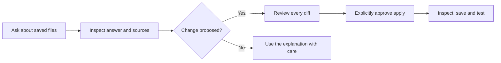

# Thread Agent

### Understand your project. Review AI suggestions. Stay in control.

Thread is a local AI assistant inside **Visual Studio Code (VS Code)**, the app you use to open and edit code. Ask where something happens, get help investigating a bug, review a suggested change, or summarize a document. Thread 0.2.1 uses a **model you supply**, running on your computer through **Ollama**; the main workflow needs no paid AI account or API key.

**Next publication scope:** automate the existing universal Python-source VSIX upload as 0.2.1, with MIT, stable Marketplace channel and experimental preview label. Python 3.9+ remains a user prerequisite. The source workflow stages only approved source/assets, defaults to dry-run and publishes the reviewed exact bytes only after the protected main approval. Native packaging work is preserved separately. [Source upload workflow](docs/source-vsix-upload.md).

> [!IMPORTANT]
> **Experimental developer preview.** Answers and generated code can be wrong. Thread shows source excerpts and asks you to review changes. The new bundled-backend and offline paths are development candidates, not a finished release for every operating system.

**Explore:** [What it does](#what-can-i-do) · [Choose setup](#choose-your-setup) · [First task](#try-your-first-task) · [Platform status](#platform-status) · [FAQ](#questions-and-help) · [For contributors](#for-contributors)

| 🔎 Understand | 🛠️ Investigate | ✍️ Change | 📄 Summarize |
| --- | --- | --- | --- |
| Ask how your project works, with source references. | Describe an error and inspect a proposed explanation or fix. | Review changes to up to four eligible text files. | Choose text, PDF text or a Word document's main body. |

## What can I do?

| You ask | Thread helps by | Your part |
| --- | --- | --- |
| “Where does this project read its database settings?” | Finding relevant saved source excerpts and explaining them. | Open the sources and check the explanation. |
| “This function gives the wrong result. Why?” | Using your description, source and VS Code diagnostics. | Check the diagnosis; review any proposed fix. |
| “Add input validation to this function.” | Proposing bounded file changes with before/after diffs. | Review each diff, explicitly approve, then inspect/save/test. |
| “Summarize the requirements in this document.” | Summarizing a selected file or range with extraction notes. | Check what was included or omitted. |

Thread reads a bounded selection of **saved files**, rather than understanding every file at once. Save relevant files and open the one you are asking about. It cannot operate debugger breakpoints, silently run generated commands, or remember all earlier conversations. [Detailed limits →](docs/vscode.md#files-documents-and-model-limits)

## Choose your setup

**New here? Start with the VS Code guide.** The existing Python-based preview is the practical route today; the native lightweight and offline routes below are being validated.

| Route | What you need | Where to start |
| --- | --- | --- |
| **Existing editor preview** | VS Code 1.95+, Python 3.9+ and a local text-generation model. Optional confirmed setup installs only the runtime; you supply models. | [Build/install and first setup](docs/vscode.md#build-and-install-from-this-public-repository) |
| **Lightweight native candidate** | A matching platform VSIX containing the backend; your existing local model/server or a confirmed runtime-only install. No model weights are bundled or downloaded. A correctly built native package removes the separate Python requirement. | [Distribution paths and prerequisites](docs/distribution-modes.md) |
| **Offline native candidate** | Matching VSIX and your own trusted runtime/model bundle, or an existing local Ollama installation. No official companion ZIPs are shipped in 0.2.1. | [Offline import steps](#offline-setup-in-plain-english) |
| **Simple field lookup** | Git and Python 3.11+. No AI model or GPU required. This is a separate command-line tool. | [Try a field lookup](#try-a-field-lookup-without-ai) |

A **VSIX** is a VS Code extension installer. A **model** is the downloaded AI data used to generate answers. A **companion bundle** contains the additional files needed for offline setup; it can be much larger than the extension.

> [!NOTE]
> The owner reported publishing version **0.2.0** as `Krishnendra.thread-agent`. The next owner-approved preview is **0.2.1**; its local candidates have not been published to Marketplace. A public repository or passing CI does not make a new installer available. Check the [release checklist](docs/releasing.md) before distributing packages.

### Install and open the editor preview

1. Follow the [build/install guide](docs/vscode.md#build-and-install-from-this-public-repository) to obtain the local VSIX. Building from source needs developer tools and internet access for dependencies.
2. In VS Code, open **Extensions → … → Install from VSIX…** and select your installer.
3. Open a project you trust. From the Command Palette, run **Thread: Setup Local Model**. The Python-based preview automatically detects Python 3.9+.
4. Select an installed local text model. Use **Use existing Ollama (Recommended)**; optional **Install local runtime only** never supplies models.
5. Open the **Thread** sidebar and choose a workflow.

Downloads need internet and sufficient storage/memory. They do not happen because an AI answer tells Thread to install something. [Setup sizes, terms and recovery →](docs/local-setup.md)

### Offline setup in plain English

1. Obtain the matching VSIX and supply your own complete, trusted runtime/model bundle. Ready-to-use official companions are outside the 0.2.1 release scope.
2. Transfer both to the offline computer and install the VSIX.
3. Run **Thread: Import Offline Local AI**, select the unpacked companion folder, and compare the shown manifest SHA-256 with the distributor's trusted record. SHA-256 is a fingerprint used to detect changed bytes; it does not prove who made the bundle.
4. Review and explicitly approve the native programs being imported. Thread copies/checks the files, starts its local model server and checks the selected model before activating it.
5. Keep one Thread window active during import. Cancel or a failed import preserves the previous selection and removes incomplete copied files.

One real Apple Silicon Mac import and model response passed with external networking denied. Clean-machine setup and model inference on the other platforms remain to be verified. The companion assembler is a developer tool, not a download service. [Trust boundaries and complete bundle requirements →](docs/distribution-modes.md)

## Try your first task

**Example walkthrough — not a screenshot or a guarantee of model output.** Suppose your saved project contains a small `add` function that subtracts instead of adding:

```python
def add(a, b):
    return a - b
```

1. Open that file and run **Thread: Diagnose a Problem**.
2. Enter: “`add(2, 3)` returns `-1`; I expected `5`. Explain why and propose a fix.”
3. Read the explanation and captured source excerpts. If Thread proposes a change, choose **Review proposed changes** and **Review a diff (recommended)**.
4. Inspect every proposed diff and explicitly mark it reviewed. Choose **Apply to editor buffers**, then confirm **Apply reviewed changes**.
5. Inspect/save the result and run your project checks. Thread can run an existing VS Code task only after you select and confirm it; inspect its terminal output yourself.



You can also refine the proposal with your own instructions, choose **More options**, **Pause review**, or **Cancel proposal**. Custom text and silence do not approve a change. Changed source files invalidate an old proposal. Thread does not automatically save existing-file edits, commit or push; creating an approved new file may write it to disk. [Review controls →](docs/vscode.md#review-and-apply-a-feature-or-fix)

## Platform status

**Native backend CI passed on all six targets** for [commit `3e436ad`](https://github.com/KrishnendraPrakash/thread/commit/3e436adaaa625b26831c8d8a8148f18245d7ee30): builds, JSON/dependency probes, source-boundary tests and synthetic offline-import tests. [Inspect the native run →](https://github.com/KrishnendraPrakash/thread/actions/runs/38142298112)

| Computer | Native backend check | Full editor / real offline AI |
| --- | --- | --- |
| Apple Silicon Mac (ARM64) | Passed on macOS 14 runner | Local editor fixtures and real offline AI trial passed on the development Mac; clean-machine certification pending. |
| Intel Mac (x64) | Passed on macOS 15 Intel runner | Full editor and real model trial pending. |
| Linux x64 | Passed on Ubuntu 22.04 runner | Full editor and real model trial pending. |
| Linux ARM64 | Passed on Ubuntu 24.04 ARM runner | Full editor and real model trial pending. |
| Windows x64 | Passed on Windows 2025 runner, including native handle-read tests | **Editor activation remains gated** pending broader document/edit integration validation. |
| Windows ARM64 | Passed on Windows 11 ARM runner, including native handle-read tests | **Editor activation remains gated** pending broader document/edit integration validation. |

These runner versions are test environments, not a certified minimum OS list. Native CI does not download/run a model. Web, 32-bit and remote-host profiles are outside this initial target matrix. Signing, complete third-party notices and the owner license remain release blockers. [Current evidence and remaining gates →](steering/status.md)

## Questions and help

Click a question to expand it.

<details>
<summary>Does my code go to a cloud AI service?</summary>

The implemented AI path calls a local Ollama server on loopback (your own computer). There is no silent paid/cloud fallback. Confirmed setup downloads runtime/model assets; VS Code and tasks you explicitly run can have their own network behavior. Thread's process boundary is not an OS sandbox. [Privacy details](extensions/vscode/PRIVACY.md)

</details>

<details>
<summary>What does Thread store, and how can I stop it?</summary>

The latest completed editor analysis is saved in workspace state, including source excerpts, proposals and model inputs/outputs. **Thread: Clear Saved Analysis** clears the active entry; it does not erase VS Code backups or undo history. **Thread: Cancel Current Request** stops the client request; a local model server may briefly finish its work. Stop an already approved VS Code task using VS Code task controls. Runtime/model files are separate from analysis. [Storage and cancellation](docs/vscode.md#storage-cancellation-and-troubleshooting)

</details>

<details>
<summary>Can it summarize any PDF or Word file?</summary>

It extracts PDF text and DOCX main-body text, plus supported UTF-8 text files. It does not perform OCR on scans or inspect document images, and Word headers/footnotes may be omitted. Select a smaller page/paragraph/line range when needed. Check extraction notes. [Formats and limits](docs/vscode.md#files-documents-and-model-limits)

</details>

<details>
<summary>Setup or a request failed. What next?</summary>

Rerun **Thread: Setup Local Model** and check the reported backend/model status. For the Python-based package, install a maintained Python 3.9+ if none is detected. Choose a local text-completion model rather than an embedding/cloud model. For rejected output, ask a narrower question; for stale changes, inspect the current files and request a new proposal. [Troubleshooting guide](docs/vscode.md#storage-cancellation-and-troubleshooting)

</details>

<details>
<summary>Is it a finished autonomous agent? Can I redistribute it?</summary>

This is a bounded preview. Durable knowledge memory, independent semantic verification and optional hosted/private adapters remain planned. No full M0/M1/model benchmark gate has passed. Thread-authored code and documentation use the owner-approved **MIT** license. Included dependencies, runtimes and models retain their own terms; complete binary notice review remains open. Complete portable-Python notices and signing decisions remain open. [Roadmap](AGENT_PLAN.md) · [Release checklist](docs/releasing.md)

</details>

## Try a field lookup without AI

This separate CLI reports an exact TOML/JSON value and its source fingerprint. It does not provide general chat. You need Git and Python **3.11+**; installation may download build tooling.

<details>
<summary>macOS or Linux commands</summary>

```bash
git clone https://github.com/KrishnendraPrakash/thread.git
cd thread
python3 -m venv .venv
source .venv/bin/activate
python -m pip install -e .
thread-agent ask --file examples/projects/minimal/settings.toml --field /database/default
```

</details>

<details>
<summary>Windows PowerShell commands</summary>

Verify `py -3 --version` reports 3.11+ first. Full Windows CLI installation remains to be tested; native source-read CI is a narrower check.

```powershell
git clone https://github.com/KrishnendraPrakash/thread.git
cd thread
py -3 -m venv .venv
.\.venv\Scripts\python.exe -m pip install -e .
.\.venv\Scripts\python.exe -m thread_agent ask --file examples/projects/minimal/settings.toml --field /database/default
```

</details>

Already cloned? Skip the first two commands and reuse your environment. The report includes **`"value": "sqlite"`**, a source path, field and hash. This describes captured file content, not a running database. [Full CLI guide, sessions and replay →](docs/first-workflow.md)

## For contributors

| I want to… | Read this |
| --- | --- |
| Build and run checks | [Development guide](docs/development.md) · [Contributing](CONTRIBUTING.md) |
| Understand the code layout | [Component map](docs/structure.md) |
| Explore the design | [Workflow diagrams](docs/workflows.md) · [Specification](SPEC.md) · [Rationale](RATIONALE.md) |
| See implemented vs planned work | [Current status](steering/status.md) · [Roadmap](AGENT_PLAN.md) |
| Work on native/offline packaging | [Distribution modes](docs/distribution-modes.md) · [Trial evidence](docs/distribution-trial.md) |
| Prepare a public preview | [Publishing guide](docs/publishing.md) · [Release checklist](docs/releasing.md) |
| Report a problem | [GitHub issues](https://github.com/KrishnendraPrakash/thread/issues) — include your OS, version and reproducible steps; remove secrets. |

Tests and synthetic traces demonstrate specific behavior; they are not accuracy benchmarks. Keep the primary path usable without paid API credentials. Follow [AGENTS.md](AGENTS.md) for project agreements.

[↑ Back to top](#thread-agent)

### Publishing automation preparation

An [inactive Marketplace automation draft](docs/marketplace-automation.md) now proposes protected GitHub environment approval and Entra OIDC publishing of exact six-target packages. It does not run or publish. Release gates remain pending, the native release builder is unfinished, and protected Azure/GitHub access and identity lookup are verified. Marketplace Contributor membership is owner-reported and awaits independent verification. The existing public extension is updated through the same `Krishnendra.thread-agent` identity.

Local release automation now includes model-free host-native candidate packaging, separate user-bundle assembly and six-target inventory aggregation, and a resumable upload/listing controller with a durable exact-release ledger. Both production workflows remain inactive under `release/*.yml.disabled`. Production execution and validation and five remaining evidence gates remain pending for BYO 0.2.1; no new public package is provided by this preparation.

Both inactive release workflows now pin every Action to a verified official upstream commit and disable persisted checkout credentials. Recovery restores only a validated same-commit publishing attempt. A CI-only review can exercise native probes and synthetic recovery tests without enabling publishing or resolving production release gates.

## Publishing identity lookup

The manual `Marketplace identity lookup` workflow resolves the publishing managed identity’s Marketplace User ID on `main` after owner approval in the protected `marketplace-publish` environment. It authenticates through GitHub OIDC and returns only the nonsecret profile ID. It does not publish extensions or assign Marketplace roles. The lookup is setup verification, not a completed release gate.

Cross-platform validation found and corrected Windows upload-ledger lock cleanup: the file handle closes before lock deletion. Recovery still stops after uncertain uploads. This does not enable publishing.

The owner approved **MIT** for Thread and **0.2.1** for the next preview. Root `LICENSE`, Python metadata and extension metadata now agree. Third-party components retain their own licenses; [licensing scope and notice review](docs/licensing.md) describes the remaining redistribution gates. These source changes are not published.

Private Mac 0.2.1 installation checks passed for an offline-installed Python wheel and an isolated native VSIX profile. The local runtime produced a simple offline completion, but one structured Qwen 0.5B repository request was rejected as incomplete; model suitability and other-platform editor/inference checks remain open. Packaging preserves the exact MIT text and third-party notices. No new public installer is published.

A follow-up draft adds Windows x64 document/proposal/frozen-protocol fixtures and verifies that the Windows product guard still blocks setup. It also retains source-bound static dependency notices for the verified portable Mac Python build, including OpenSSL 3.5.9. These are core/transport fixtures and notice provenance checks, not Windows UI, real-model or clean-machine certification. Publishing stays inactive and the production gates remain pending.

Git now preserves project-license and dependency-notice bytes across platform checkouts, so Windows newline conversion cannot invalidate the reviewed SHA-256 records.

An approved follow-up adds a real Windows x64 VS Code extension-host test using pinned Microsoft VS Code 1.141.0 and @vscode/test-electron 3.1.0. It installs a private CI-only native VSIX into empty profiles and checks installed metadata/license, activation/commands, native no-Python probing and expected guard rejection. It does not enable positive Windows workflows or publishing. A clean CI profile is not a bare consumer Windows machine.

The pinned Windows Code archive uses a commit-prefix wrapper directory. Test acquisition preserves the verified side-by-side executable/runtime layout before invoking Code; its version, commit and byte digest remain checked.

Installed-host guard observation uses the actual activated module's error handler, preserving its original behavior and the shipped guard. It avoids relying on a separate test extension's notification API facade.

### Isolated positive Windows integration

The next private Windows check retains the production guard control and builds a separate CI-only candidate omitting only its platform rejection in temporary staging bytes. It tests installed commands, native validation and actual editor edits with scripted approval and a synthetic loopback provider; a second host launch checks renewed review after reload. Production source remains guarded. No real-runtime/model or ordinary-user readiness is implied. See [extension limits](extensions/vscode/README.md) and [remaining notice review](docs/licensing.md). The old Mac companion must be rebuilt with the final notices. Full release gates and protected publication stay inactive.

Positive Windows CI exposed a real workspace-identity mismatch between VS Code short paths/drive casing and Python final paths. Review/file-URI and dirty-buffer checks now resolve Windows paths through the native filesystem API on both sides, preserving case-sensitive component distinctions and rejecting different or missing workspaces. The shipped Windows guard remains in place; the correction passed the actual installed Windows fixture.

Windows candidate execution also demonstrated LF proposals becoming CRLF in newly created editor buffers. Edits now explicitly preserve consistent proposal line endings; mixed/bare-CR content is rejected before dispatch. Exact post-edit validation and uncertain-outcome handling remain mandatory. The actual installed fixture covers both LF and CRLF creation; The actual installed Windows fixture passed LF and CRLF creation.

The pinned VS Code SDK disables disk storage during extension tests. The positive reload fixture therefore uses a private development driver without extensionTestsPath in the same disposable profile, allowing ordinary storage across two launches. The official binary is unchanged. The guard control continues using the standard SDK host; no normal user profile or model/runtime is involved.

Verified private Windows result (2026-10-12): [run 38209002553](https://github.com/KrishnendraPrakash/thread/actions/runs/38209002553) passed at source commit 256d159cbc2636485d28333cb11033ec4af970a5; all 19 branch/PR checks passed and no CI artifacts were exported. The unchanged installed package retained its Windows guard. The private candidate passed actual native inventory/setup selection, reviewed replacement remaining unsaved, LF/CRLF creation, pause/cancel, dirty/stale and duplicate rejection, and mixed-ending rejection before any staged creation or buffer edit. Two ordinary isolated Code launches retained the pending proposal and required renewed diff review. A private development driver avoids the SDK's deliberately in-memory extension-test storage; no binary is patched. Synthetic HTTP responses and scripted approvals are not real-model/runtime, manual UX, ordinary-user, bare-machine or Windows ARM certification. The source guard and global release gates remain unchanged. Draft PR: https://github.com/KrishnendraPrakash/thread/pull/6.


A manual runtime-integration suite now tests pinned Ollama 0.34.4 and Qwen2.5-Coder 0.5B on standard temporary Windows x64/Linux x64 GitHub runners, capped at 45 minutes per job. It checks disk space before downloads, inventories binaries/notices before execution, stops for additional vendor agreements, and separates CPU completion from unchanged production structured-response acceptance. No model/runtime downloads run on the developer Mac, no artifacts are exported, and the production Windows guard and starter models remain unchanged. This is pending integration evidence, not model-quality or release certification.


Runtime integration attempt (2026-10-12): draft PR #7, tested head 8669617dc07b9b017d92c37f23c4d0f1e932dbbe, manual run https://github.com/KrishnendraPrakash/thread/actions/runs/38214558895. Both disk preflights passed (Windows 157846134784 bytes free, Linux 92559486976 bytes free). Windows installed the pinned runtime and produced native/runtime inventories, then stopped before execution/model acquisition because CUDNN_LICENSE.txt and MLX notices were present. Additional vendor review/approval is pending; cuDNN agreement: https://docs.nvidia.com/deeplearning/cudnn/backend/v9.18.1/reference/eula.html. Linux downloaded the pinned runtime but the production extractor rejected an archive link with “Runtime link must reference an extracted internal file”; native build/probe passed, but runtime inventory/inference did not complete. Neither job acquired model blobs or executed Ollama. No artifacts were exported and no release guard was changed. Source CI passed; no real inference or model-quality result is claimed.


A separately selected manual `runtime-metadata` diagnostic reads only the exact approved Windows/Linux archive manifests and license text on temporary GitHub runners. It neither extracts nor executes payloads or acquires models; archives are deleted after inspection. This diagnoses the unresolved cuDNN notice and Linux archive-link rejection without continuing the blocked integration suite.


Metadata-only diagnosis passed on both runners: the cuDNN-named and MLX notices in the approved main Windows archive are permissive texts, with no cuDNN/MLX runtime binaries present. No extra SDK acceptance is needed for those exact notices. The audit now distinguishes exact inspected notice hashes from unapproved binaries. Linux extraction now supports bounded internal file-link chains by regular copying, retaining containment and size limits; synthetic security regressions pass. Real inference has not been rerun. [Evidence, exact component revisions and conditional SDK approval →](docs/runtime-integration.md)


Real integration retries exposed a Windows CI cleanup defect: the PowerShell ownership query returned system-process paths, so prior Windows cleanup attempts cannot establish owned-only termination. Affected temporary runs were requested force-stopped. Cleanup now treats process-query output solely as metadata and independently filters exact dedicated-directory paths in Node, rejects ambiguous identities, and rechecks executable/PID ownership before direct termination. Portable regressions exclude system paths, sibling prefixes, traversal, empty roots and duplicate IDs. Linux integration passed in multiple runs; one intervening zero-VRAM assertion failed and remains an unresolved inconsistency. No zero-VRAM check was weakened. Model outputs on both platforms were rejected separately from CPU completion.


The real CPU integration harness now explicitly selects Ollama’s documented `OLLAMA_LLM_LIBRARY=cpu`, disables Vulkan/integrated GPU discovery and masks accelerator visibility only for the owned test runtime child. This addresses a runner residency discrepancy without changing production settings or the captured structured request. Zero-VRAM assertions remain mandatory before/after the production call. Windows owned-process classification regressions remain enabled before acquisition.


Final Windows x64/Linux x64 real runtime integration passed at d003dbfd403e079c6f9ea196f74d9ebd406c1836: https://github.com/KrishnendraPrakash/thread/actions/runs/38218047751. Both actual native installs, exact model acquisition, CPU READY completions, unchanged structured-request capture, source preservation and independently checked zero-owned-process cleanup passed; zero VRAM before/after and zero artifacts. Production model answers were rejected separately (Windows invalid source references; Linux prohibited ask-mode edits), so model suitability remains unresolved. Earlier Windows cleanup filtering was defective and affected runs were cancelled; independent Node ownership checks and regressions now enforce the boundary. The production guard/starter list remain intact and release gates remain pending. See docs/runtime-integration.md for exact tested head, prior failures and limits.


Cleanup incident clarification: in cancelled run 38217103078 (head d5885b0), the pre-termination record listed unowned lsass.exe PID 1008 first, followed by svchost.exe PID 716. The exact sequential cleanup code reached PID 716 and logged its failed taskkill, with no failure logged for PID 1008. This establishes by control flow that the unowned PID 1008 termination command returned success; it was not merely a query. Successful stdout and an independent post-kill probe were not retained, so the actual process exit and full OS impact cannot be independently reconstructed. It would be incorrect to claim no unowned processes were terminated. The impact was confined to disposable Windows CI runners, whose teardown stalled; affected runs reached terminal cancelled state. Final corrected runs independently enforce ownership and report zero remaining owned processes. No user Mac process was involved.


Local packaging preparation now records exact PyInstaller BINARY and EXTENSION source/payload hashes while keeping redistribution review false. A private existing Mac backend copy has refreshed plaintext notices with unchanged non-notice bytes; its compiled installer still needs a final rebuild. Five target payload/source inventories and the release model decision remain unavailable/pending. No acquisitions, packaged-backend/Ollama/model execution, signing or remote changes were performed. [Concrete local inventory evidence](docs/local-packaging-inventory.md).


Current owner-approved 0.2.1 scope: six model-free native VSIXs; users supply models. No starter-model downloads or official companion ZIPs are shipped. User-owned offline import is preserved. The exact-scope companion-distribution gate is not applicable; five notice/editor-inference/Windows/clean-machine/signing gates remain pending. No signing, hosting, workflow activation or publication occurred.


The approved build-only CI now creates a temporary model-free VSIX on each of the six standard hosted targets, probes its actual native backend, verifies BYO package identity/content and prints exact native-file/source/notice inventory metadata. Packages are deleted on the runner; no artifacts, model/Ollama acquisitions, OIDC or publishing are involved. This does not advance ordinary-user, real-inference, complete licensing or signing gates.


Six-target temporary BYO VSIX proof passed at 50eec6cd8ad18ca69853f14ba48666801480f57e: https://github.com/KrishnendraPrakash/thread/actions/runs/38243563529. Actual packaged native protocol, model-free contents, per-file/source/notice inventories and synthetic offline import passed on Windows/macOS/Linux ARM64/x64; temporary packages were removed, with zero artifact exports. A Windows UTF-8 decoding fix resolved the first run. These results do not establish ordinary-user trust, real editor/inference, complete redistribution rights or signing. All five production gates and Windows activation remain pending. [Evidence](docs/byo-package-checks.md).

Local notice preparation (2026-10-12): [exact CPython core mappings and remaining distribution inputs](docs/byo-notice-progress.md) cover the recorded Mac/Linux source hashes and reject executable images mistaken for notice text. This is locally tested preparation; native notice completeness and publication remain pending.

Owner-approved follow-up: six free hosted targets collect exact installed distribution origins, versions and bounded original notice text; existing SDK redist hashes are compared without acquiring an SDK or accepting terms. Pinned Mac OpenSSL 3.0.16 and incorporated CPython license text supplement the exact core mappings. This work is under review; it does not promote the notice gate or activate publication.

Actual first provenance pass passed all six targets. Follow-up exact Ubuntu shared-library notice bindings retain full distribution copyright/source access; Windows 10+ packaging omits only OS-origin API-set/UCRT copies and probes the resulting package. No SDK terms are accepted, no redistributables are substituted, and Windows activation/publication remain gated. Full incorporated/static attribution is still pending.

Follow-up verification retains unresolved Windows copies until exact system-directory/component-store origin or installed-OS byte matching supports omission. Source paths are classified relative to trusted installation roots; notice links cannot escape their declared roots. Actual six-target results and Microsoft vendor-runtime obligations are tracked in the notice progress report.

Windows provenance traced the unwanted OS DLL copies to the runner JDK on PATH. Native build discovery now uses only selected Python/Windows roots; actual native probes run with nonexistent PATH/Python overrides. CPython packaging changes are summarized alongside its retained terms. The notice gate stays pending until final payload evidence and outstanding vendor/static obligations are resolved.
