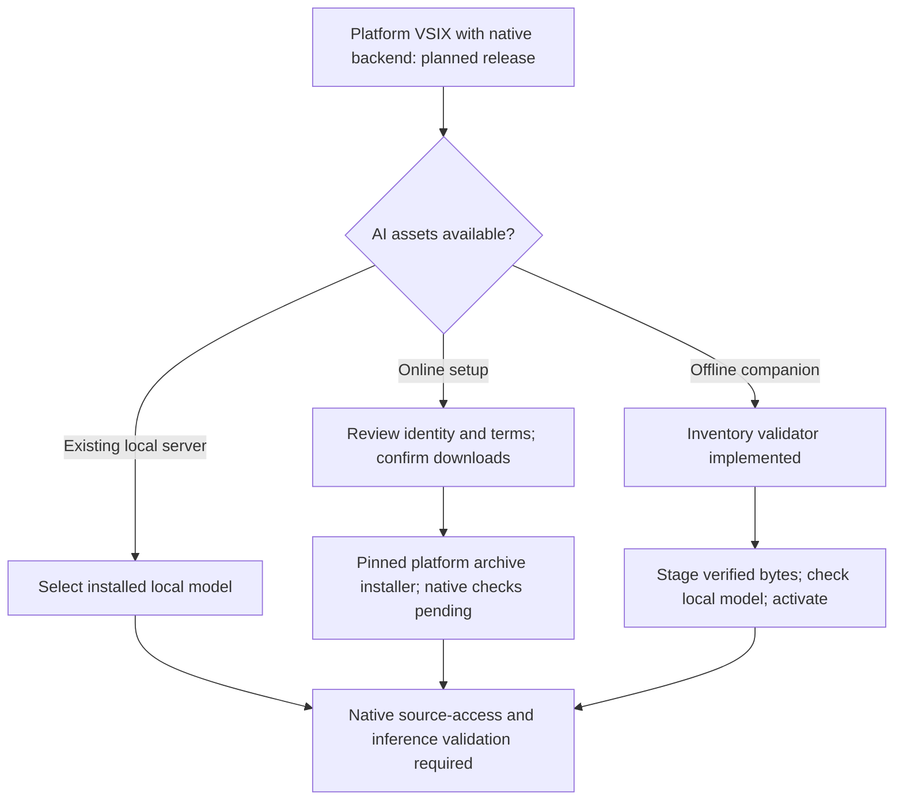

# Distribution modes under development

The owner requested Windows, macOS and Linux from the start, with both online first-use setup and an offline option. The goal is no separate user Python installation. These are authorized requirements, not delivered platform support.

## Two intended installation paths

**Lightweight:** install a platform-specific VSIX containing the native backend, choose a local model, explicitly confirm runtime/model acquisition, then use local inference. Model weights stay outside the VSIX. An existing local Ollama server remains an alternative.

**Offline:** obtain the platform-specific VSIX and its matching companion bundle on a connected machine, transfer both to the offline computer, install the VSIX, and run **Thread: Import Offline Local AI**. Select an unpacked bundle folder, compare its manifest SHA-256 with the trusted distributor's record, and approve the named native-code import. Thread streams assets into private staging, verifies copied bytes, commits the directory, starts its owned loopback server and checks the model's local completion capability before activating the installation. Cancellation or failure removes incomplete assets and preserves the prior selection. No download request is issued by this path. One approved real Mac bundled-model offline trial passed with external networking denied; clean-machine operation and other platforms still require validation.

The companion must include native backend, inference runtime, complete model-store manifests/blobs and notices. The backend used for analysis comes from the installed VSIX; the companion's backend inventory is retained for completeness rather than replacing the installed extension executable. A local-files-only companion assembler is implemented; one approved Mac private companion was assembled and tested; export automation, signed inventories and official shipped bundles remain pending. This importer accepts explicitly trusted user-selected native assets; hashes alone do not establish distributor authenticity.

Offline copying uses an exclusive `import.lock` in extension-owned storage. Concurrent copy attempts stop; repeat completed imports keep separate verified copies rather than overwriting prior installations. If a process crashes, close all Thread windows before removing only that lock and uncommitted `staging-*` directories. Keep committed `bundle-*` directories. Use one active Thread window during import and activation; copying is serialized, but workspace/global selection and running model servers are not a cross-window transaction. Imported `bundle.json` and `import.json` preserve the approved digest and import provenance; capability checks are distinct from model inference validation.

## Target matrix

| Target | Packaging foundation | Current repository access | Managed AI acquisition |
| --- | --- | --- | --- |
| darwin-arm64 | Native launch/build configuration | Existing macOS-tested POSIX path | Existing macOS 14+ installer |
| darwin-x64 | Native launch/build configuration | POSIX path; no new native validation | Pinned archive installer; unverified on Intel Mac |
| linux-x64 | Native launch/build configuration | POSIX path; no local Linux execution in this task | Pinned Zstandard archive installer; unverified |
| linux-arm64 | Native launch/build configuration | POSIX path; no local Linux execution in this task | Pinned Zstandard archive installer; unverified |
| win32-x64 | Native launch/build configuration | Handle-relative implementation; editor gate remains blocked pending native checks | Pinned ZIP installer; unverified |
| win32-arm64 | Native launch/build configuration | Handle-relative implementation; editor gate remains blocked pending native checks | Official ARM64 ZIP verified in metadata; execution unverified |

32-bit, web and remote-host profiles are excluded from this initial target matrix. Listing a target does not certify its OS minimum, hardware suitability or inference support.

## Implemented foundation

The extension prefers `native/<target>/thread-backend/thread-backend` (`.exe` on Windows), probes it through the existing bounded JSON protocol, and launches it without interpreter flags. Packages without that asset retain existing Python discovery. Managed macOS installation can call the packaged backend's explicit `install-runtime` command. Windows remains blocked rather than replacing descriptor-based reads with weaker path checks.

`extensions/vscode/scripts/freeze.py --target <target>` describes a native one-folder build using **already installed** PyInstaller plus the editor dependencies. It refuses a target different from the build host. With explicit owner approval, pinned PyInstaller and zstandard were installed in project-local environments, and two darwin-arm64 native candidates were built and probed. Signing, provenance, notices, platform-specific VSIX verification and executable permissions must be validated before distribution. Current release checking still accepts only the existing POSIX profiles and is not yet a frozen-package release gate.

`offline_bundle.validate_bundle` remains a development inventory audit; its assembler copies explicitly inventoried local inputs into a new companion without downloads/execution. The extension importer additionally requires manifest fields `runtimeExecutable`, `runtimeVersion`, `modelDirectory` and `model`, verifies inventory roles and streams only listed assets. `bundle.json` has `schema: 1`, a matching `target` and an `assets` list. Each regular, unlinked asset requires `path`, `role`, `size`, `sha256`, `source`, `license` and `version`. Roles must include backend, runtime, model and notice. Optional boolean executable flags authorize execute permissions only for backend/runtime assets, including inference helpers. Traversal, duplicate paths, links, missing provenance and changed bytes are rejected. Imported executable/model paths must point into the verified inventory. A signed/trusted release inventory is still required for official distribution; importer approval authorizes the selected native code rather than establishing its safety.

## Distribution constraints

The private native Mac candidates are 15,551,982 bytes (Homebrew Python 3.12) and 9,243,875 bytes (Apple CLT Python 3.9). Both include bundled Python and pass extracted-package protocol/dependency probes. Existing documented AI estimates are 160 MB for the pinned macOS runtime plus about 986 MB or 4.7 GB for the starter model. An offline companion avoids retransmitting these weights on every extension update. Models and runtime distributions require artifact-specific redistribution review and retained notices; license strings in a manifest do not grant redistribution rights. The owner's project license is still unresolved.

Windows source access now uses `NtCreateFile` opens relative to retained directory handles, no reparse processing, disk-file/type/link checks and denied write/delete sharing. Native enumeration marks reparse entries excluded. Tests for real junctions and hard links are prepared but skipped on Mac. The editor gate stays closed until native source, document and edit checks pass. POSIX tests cannot establish Windows behavior. Linux builds need an explicit native library/OS baseline. macOS releases need signing/notarization validation. All profiles need clean-machine setup and inference checks; no such cross-platform claim is made here.

## Verified provider metadata and pending native checks

Ollama 0.34.4 metadata from the [official release](https://github.com/ollama/ollama/releases/tag/v0.34.4) records macOS archive 160 MB, Linux x64 1.43 GB, Linux ARM64 1.55 GB, Windows x64 1.46 GB and Windows ARM64 208 MB. `runtime_assets.py` pins exact byte sizes and SHA-256 digests. Only the explicitly approved Mac archive was downloaded in the later local trial; Windows/Linux archives remain metadata-only. ZIP/tar extraction rejects unsafe paths and external links; Linux Zstandard decoding needs the build-only dependency in `requirements-native.txt`. Native packages bundle that decoder, so users do not install it. Current conservative temporary-space checks allow roughly 19 GB for Linux runtime extraction and 11 GB for Windows x64, before model-space checks; these are safety allowances, not measured minimums.

All six pinned metadata entries were independently cross-checked against the release API and its `sha256sum.txt` on 2026-10-11. Mac archive bytes and one local native inference trial now passed; other runtime archive bytes/native behavior remain unverified. Decoder availability is checked before a Linux download; an invalid existing runtime marker/executable identity stops reuse without overwriting the existing installation. Tar extraction checks count/size limits incrementally, including materialized internal-link copies.

The [Ollama license](https://raw.githubusercontent.com/ollama/ollama/v0.34.4/LICENSE) is MIT and requires retaining its notice. Individual runtime distributions include additional dependencies whose notices and redistribution terms still need artifact inspection. Starter model terms must be retained with exact artifact provenance; mutable model tags are not a reproducible offline release inventory.

The branch-scoped `native-backend.yml` workflow prepares native builds on all six host architectures, tests Windows handle boundaries, probes frozen JSON execution and runs synthetic offline-import tests. It has not been dispatched. Its artifacts retain validation text and notice provenance only; binary redistribution remains gated, and these checks are not inference certification. Local Mac builds and extracted-package checks passed; actual macOS 14 and the other five platform executions remain pending.

## Local portability evidence — 2026-10-11

`artifacts/thread-agent-0.2.0-darwin-arm64-local.vsix` uses the existing Homebrew Python 3.12 and collected Mach-O libraries requiring macOS 26.0. `artifacts/thread-agent-0.2.0-darwin-arm64-local-macos14.vsix` reuses the already installed Apple CLT Python 3.9.6; its collected Mach-O maximum minimum is 14.0. This avoids downloading another interpreter, but Python 3.9 is an experimental portability route rather than the maintained public release baseline. Both candidates executed only on macOS 27.0.1. A maintained Python build on the intended oldest native runner, complete distributor notices and real minimum-OS execution remain release requirements. No Mach-O headers were patched to claim compatibility.

The macOS 14 candidate SHA-256 is `094732f7cd609ef41ad683efdd92382e166615c196d0f92d71b4d2720994dc91`; the macOS 26 candidate is `e7cecf50109355fc43340da56e619934f8936d609ca04e37383e85873d2d9992`. Both remain private previews with public-release readiness false. PyInstaller's generated internal aliases were materialized as regular files before VSIX packaging, allowing the normal secret scanner to run. Native provenance retains found CPython/bootloader notices and records an unresolved Python3 nearest-notice lookup; this is evidence for review, not full redistribution certification.

See [the exact pending download and remote CI proposal](distribution-trial.md). Local assembly fixtures verify copying, hash mismatch cleanup and preservation of existing bundles.

The maintained portable Python 3.12.15 Mac backend records a macOS 11.0 binary minimum and passed local native/package checks. The corrected 92-asset companion passed real offline import/inference. Executable flags for native helpers are included in the reviewed manifest; see [trial evidence and remaining limits](distribution-trial.md#completed-local-trial--2026-10-11).
