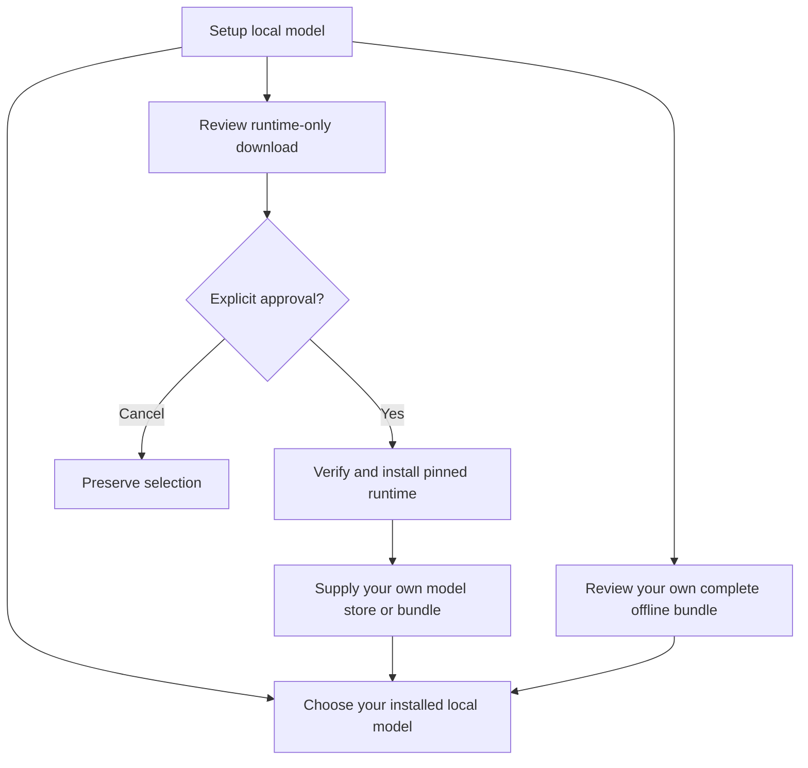

# Local runtime setup with user-supplied models

Version 0.2.1 distributes no model weights and has no model-download action. Use your existing local Ollama completion model; its license and resource needs remain your responsibility. All six Windows/macOS/Linux targets remain configured, with release validation and Windows activation still pending.

1. Run **Thread: Setup Local Model** in a trusted local project.
2. Select your installed model. If unavailable, choose **Use existing Ollama (Recommended)**, **More options** for details/custom installed-model name, or **Cancel**.
3. Optional **Install local runtime only** shows pinned Ollama 0.34.4 identity, size, destination and official terms before **Install runtime** confirmation. Installation uses checksum-verified archives and bounded safe extraction; it never installs a model, executes remote setup scripts or changes project dependencies.
4. Supply your own Ollama model store in the displayed Thread `local-runtime/models` directory, or use **Thread: Import Offline Local AI** with your own complete trusted bundle. An empty model store leaves the prior active selection unchanged and stops the temporary managed server; rerun setup after supplying models.

The runtime's initial download depends on target (about 160 MB Mac, 1.43 GB Linux x64, 1.55 GB Linux ARM64, 1.46 GB Windows x64, 208 MB Windows ARM64). Conservative disk guards remain: about 18.43 GB Linux x64 and 10.46 GB Windows x64 before runtime acquisition. Other-target metadata does not prove installation support. Native VSIXs bundle the backend and decoder; legacy packages need Python 3.9+.

Managed inference binds to a private literal IPv4 loopback port, disables cloud mode and uses Thread-owned model storage. A normal external server uses port 11434. Thread stops only its owned managed server, never the existing external server. Ollama may create per-user runtime configuration; no personal model store is silently copied or substituted. Model choice and runtime setup do not authorize source edits or tasks.

User-provided offline imports retain full schema-1 inventory, hash/provenance, native-code confirmation, cancellation and rollback checks. No official companion host is required for this release. Removing Thread-managed files must be done after closing its windows; this does not remove your independent model/runtime installation.

See [distribution scope](distribution-modes.md). Runtime/clean-machine/editor checks remain distinct from model accuracy; no model is a certified default.
